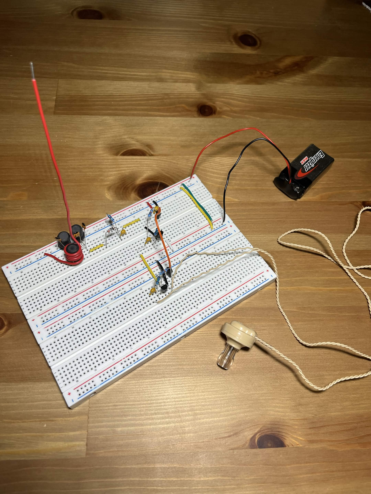
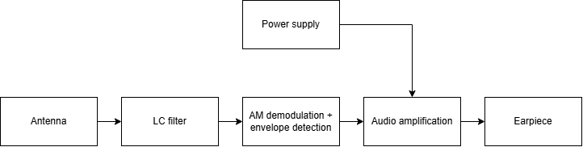
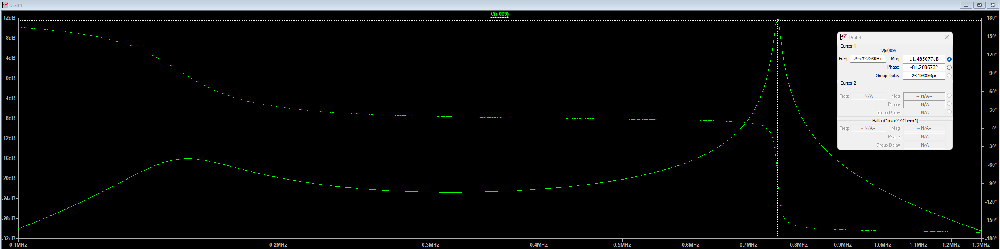
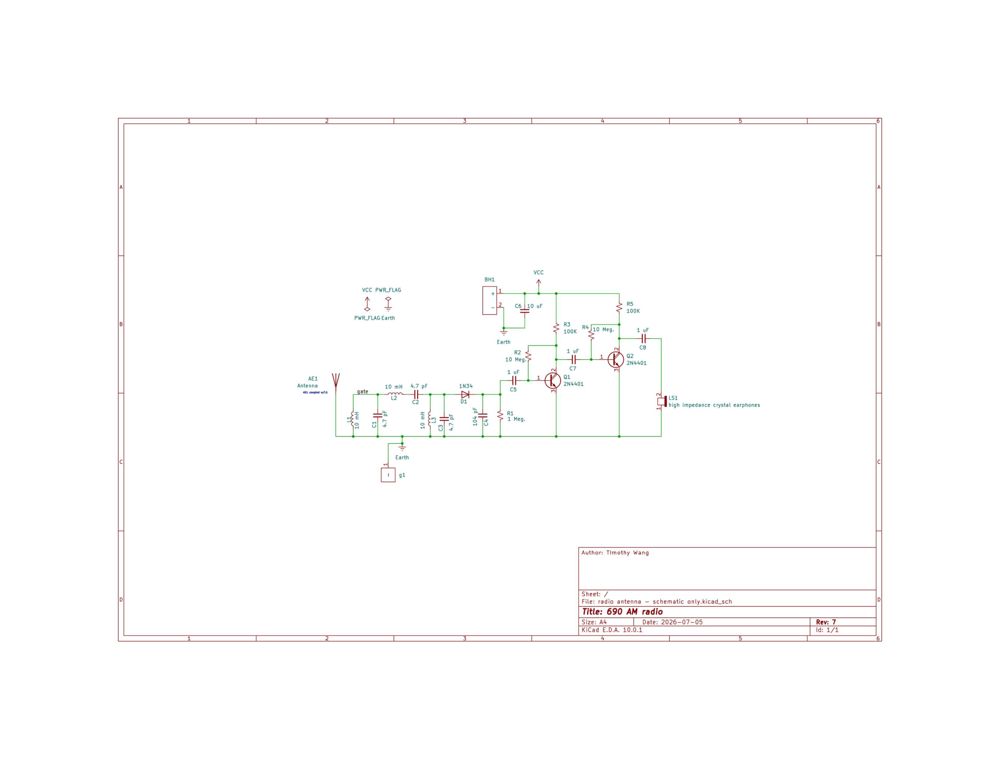

# Breadboard Radio Receiver



An AM radio receiver built from discrete components on a breadboard, including a hand-built antenna, LC filtering, and transistor amplification. Designed, simulated, and tested as a personal project from May 2026 to July 2026.

---

## Highlights

- Designed the full receiver circuit, from antenna through filtering to audio output, and got it fully working.
- Simulated multiple LC filter designs in LTspice before building, to choose an effective one with a resonant frequency of ~730 kHz.
- Cascaded additional BJT amplifier stages ahead of the earpiece, with a total gain of 56.77 dB.
- Built an antenna that fits within the 15 cm size constraint I set for myself.

---

## Overview

I built this project to apply what I learned in my physics and circuit courses, as well as to explore circuit design. The goal was to receive and play audio at the 690 kHz band using only discrete components.

## How It Works



The signal path has five main stages:

1. **Antenna:** Captures the radio signal
2. **LC filter / tuning:** Selects the desired frequency and rejects others.
3. **Detection / demodulation:** Demodulating diode and RC envelope detector extracts audio from the carrier wave.
4. **Audio amplification:** Cascaded BJT amplifier stages drive the earpiece.
5. **Audio playback:** Amplified audio signal is passed through to the earpiece.

## Design Process

### Filter design and simulation

I simulated several LC filter designs in LTspice to compare frequency response before finalizing components. I compared different combinations of series and parallel LC tuners with L = 10mH and C = 4.7pF or 5pF, and ultimately chose a design with 2 LC pairs shunted to ground with 1 LC pair in series with the top nodes of the previous 2 pairs, as it gave me the highest theoretical gain of roughly 20 dB.



### Amplifier stages

Initially the audio at the earpiece was too quiet. I added 2 extra BJT amplifier stages between the audio filtering and the earpiece, which made the sound much more audible. As well, I added collector to base bias resistors to provide the transistors with an appropriate base DC current.

### Antenna

The antenna had to meet a size constraint of 15cm. I chose to design the antenna as a monopole antenna made from 22 AWG wire. I chose this design over other designs because my antenna only needed to be good enough to capture some signal, as I was going to amplify the signal later in the circuit anyway. 

## Schematic



Full schematic: [`schematics/radio-receiver-schematic.pdf`](schematics/radio-schematic-rev-7.pdf)

## Bill of Materials

| Component | Value / Part No. | Qty | Purpose |
|-----------|------------------|-----|---------|
| BJT transistor | 2N4401 | 2 | Audio amplification |
| Inductor | 10mH | 3 | LC filter |
| Capacitor | 4.7pF | 3 | LC filter |
| Capacitor | 104pF | 1 | Envelope detection |
| Capacitor | 1uF | 3 | Coupling |
| Diode | 1N34 | 1 | Detection |
| Resistors | 0.1 Meg | 2 | Audio amplification |
| Resistors | 1 Meg | 1 | Envelope detection |
| Resistors | 10 Meg | 2 | Biasing |
| Earpiece | High impedance | 1 | Audio output |
| Wire / antenna | 15cm, 22 AWG | 1 | Antenna |
| Breadboard | 16.51 x 5.49 x 0.99 cm | 1 | Prototyping |

## Tools Used

- **LTspice:** filter and circuit simulation
- **KiCad:** schematic capture
- **Multimeter:** testing and prototyping

## Results

- Successfully received CBC Radio One Vancouver 690 AM and played audio through the earpiece.
- Final filter response: 690 kHz, 11.7 kHz RF bandwidth.
- Amplifier improvement: 56.77 dB audio signal gain.

## Challenges and What I Learned

- **Station selection:** On one of my first prototypes, I heard many different radio stations all at once. I was able to fix this by cascading multiple LC filters together, as I previously was only using 1 LC pair to filter the radio stations.
- **No audio:** On one of my earlier prototypes, I was only hearing very weak static. I was able to fix this by changing the values for the RC envelope detector to 104 pF and 1 Meg respectively, and by cascading 1 extra amplifier stage.
- **Takeaway:** I learned that ideal circuits may vary widely when comapared to their real life implementations, and that my designs must take into considerations factors that may be ignored in designing circuits in an ideal environment.

## Future Improvements

- Move the design from breadboard to a custom PCB in KiCad
- Add volume control
- Add station selection

## Repository Structure

```
radio-receiver/
├── README.md
├── docs/
│   └── images/        
├── schematics/        
├── simulations/       
└── LICENSE
```

## License

This project is licensed under the MIT License. See [LICENSE](LICENSE) for details.

## Contact

Timothy Wang | [LinkedIn](https://www.linkedin.com/in/timothy-wang-02045a3a3/?isSelfProfile=true) | tim0cwan9@gmail.com
